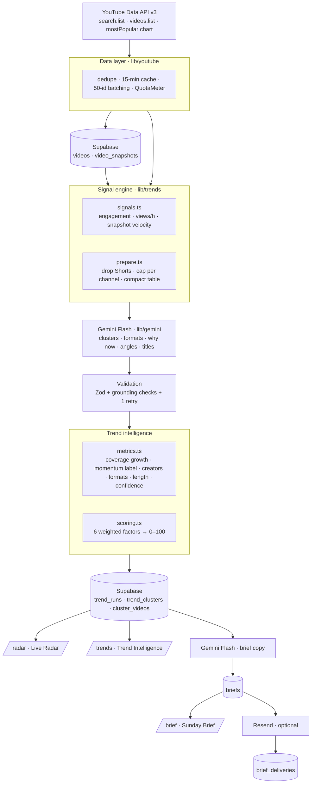
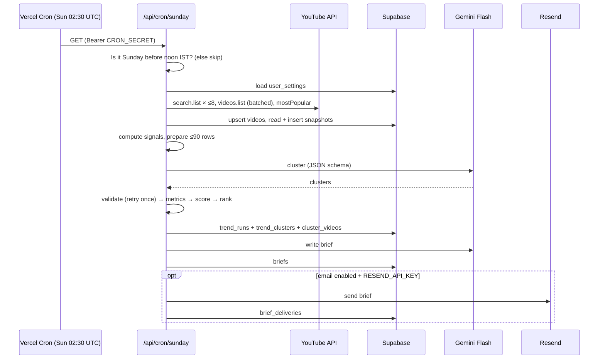
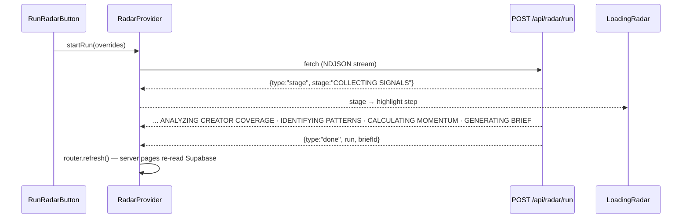
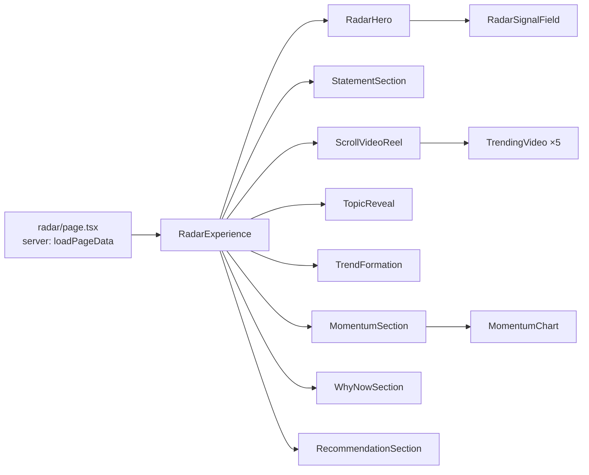
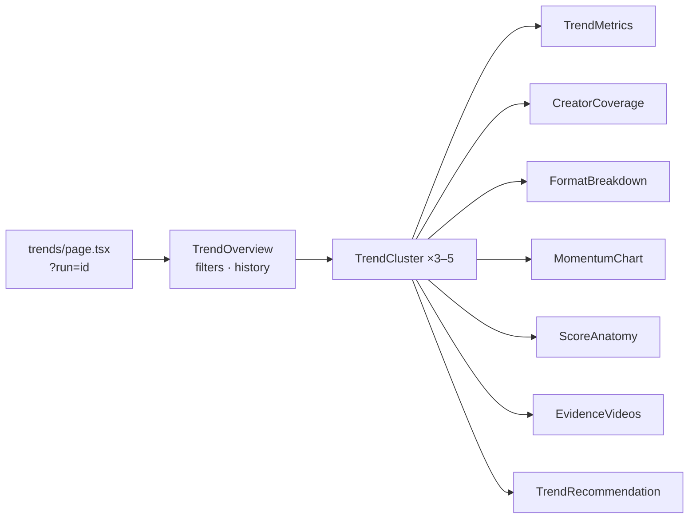

# TREND//RADAR — Components Map

This map shows how each page is assembled: its components, where their data comes from, which API route serves it, and where AI and animation are involved.

Provenance key used throughout the UI: **OBSERVED** (YouTube API), **CALCULATED** (TypeScript), **AI INTERPRETATION** (Gemini Flash), **RECOMMENDATION** (Gemini Flash, combined with calculated length and confidence).

---

## 1. System architecture

## 2. Sunday automation

Daily, separately: `/api/cron/snapshots` → `videos.list` for tracked videos → `video_snapshots`.

## 3. Manual run (streamed)

---

## 4. Pages

### `/radar` — Live Radar (`app/radar/page.tsx`)

| Component | Purpose | Data | API | AI | Animation (lib/animations/presets.ts) | State |
|---|---|---|---|---|---|---|
| `RadarExperience` | Orders the scroll story; picks the newest run (server or session) | `RadarRun` | `loadPageData` → Supabase | — | `ScrollTrigger.refresh` after mount | `useCurrentRun` (context) |
| `RadarHero` | Full-screen title, scope tags, last scan / videos analysed / active signals, CTAs, last-successful-scan banner | run, settings, failure | — | — | `heroIntro`: line mask → tagline → meta → dots → CTA last; grid drift | none |
| `RadarSignalField` | SVG radar; each dot is a real video (angle = cluster, radius = age, size = views/h) | run.clusters, signals | — | cluster labels (AI names) | `radarAmbient`: sweep rotation, dot breathing | memoised layout |
| `StatementSection` | "Doesn't trend one video at a time" → "Trends in conversations" | static copy | — | — | `statementScene`: pin + scrub, word light-up, strike, clip-path reveal | none |
| `ScrollVideoReel` | Scroll-controlled reel of the 5 fastest videos | `reelVideoIds`, videos, signals (OBSERVED + CALCULATED views/h) | — | — | `reelScene`: pin, scrub, **snap to labels**, clip-path + scale + text displacement + meta stagger, progress bar | counter via ref (no re-render) |
| `TrendingVideo` | One stage/card: thumbnail, title, channel, views, likes, comments, duration, published, category, LIVE SIGNAL; links to YouTube | `Video` | — | — | targeted by `reelScene` via data-attributes | none |
| `TopicReveal` | "But the video isn't the story. The pattern is." | static | — | — | `topicRevealScene`: pin, scale-in | none |
| `TrendFormation` | **Signature**: cluster thumbnails converge into the topic; creators / videos / coverage / avg duration / score count up | top cluster + its videos | — | cluster name (AI) | `formationScene` + `countUp` | none |
| `MomentumSection` | "Is this trend rising?" uploads/day line, verdict, coverage, explainer | `momentumSeries` (OBSERVED), `metrics` (CALCULATED), `momentumNarrative` (AI) | — | narrative | `momentumScene`: stroke-dashoffset draw, area fade, verdict scale | none |
| `WhyNowSection` | Editorial why-now + evidence grid with provenance tags | cluster.ai.whyNow + metrics | — | whyNow | `steppedScene` (pinned) | none |
| `RecommendationSection` | "So what should Ishaan make?" title, angle, format, suggested length, confidence, CTA | cluster.ai.recommendation + calculated length/confidence | — | recommendation | `steppedScene` | none |

Mobile (<900px) has no pinning: every scene falls back to `revealOnScroll`, and the reel becomes a vertical list. With `prefers-reduced-motion`, scenes are not built at all and the static layout is shown.

### `/trends` — Trend Intelligence (`app/trends/page.tsx`)

| Component | Purpose | Data | API | AI | Animation | State |
|---|---|---|---|---|---|---|
| `TrendOverview` | Header, sticky filter bar (category, region, lookback, momentum), run new radar, previous scans | run, history, settings | `loadPageData`, `POST /api/radar/run` | — | `revealOnScroll` on clusters | filter state (`useState`) |
| `TrendCluster` | Rank, name, summary, score, momentum, metrics; expandable intelligence panel | `TrendCluster` | — | name, summary, whyNow, audienceSignals, narrative | GSAP height + stagger on expand | `open` (`aria-expanded`) |
| `TrendMetrics` / `MomentumBadge` | Score, creators, videos, avg views, avg duration, engagement | `metrics` (CALCULATED) | — | — | — | none |
| `CreatorCoverage` | Real channel names with video count and views, linking to the channels | `creators` (OBSERVED) | — | — | — | none |
| `FormatBreakdown` | Horizontal bars; percentages only when ≥3 classified | `formats` (AI labels → CALCULATED shares) | — | per-video format label | — | none |
| `MomentumChart` / `ViewHistoryChart` | Uploads per day; indexed views across snapshots (only if history exists) | `momentumSeries`, `viewHistory` | — | — | path drawn by `momentumScene` on /radar | none |
| `ScoreAnatomy` | Each factor × weight → score | `scoreBreakdown` | — | — | — | none |
| `EvidenceVideos` | 3–5 videos: thumbnail, title, channel, views, duration, published, likes, comments | videos (OBSERVED) | — | format tag | hover scale | none |
| `TrendRecommendation` | What I would make · why now · possible title · format · suggested length · confidence | recommendation + calculated | — | recommendation | — | none |

### `/brief` — Sunday Brief (`app/brief/page.tsx`)

| Component | Purpose | Data | API | AI | Animation | State |
|---|---|---|---|---|---|---|
| `BriefExperience` | Composes the report and its actions | `Brief`, `RadarRun` | `loadPageData({withBrief})` | — | `revealOnScroll` on every `[data-reveal]` | none |
| `BriefHero` | SUNDAY BRIEF, Sunday date, region, categories, videos analysed, headline, dek | brief + run | — | headline, dek | reveal | none |
| `TopOpportunity` | THE ONE TO WATCH: why it matters, momentum, creator coverage, recommended action | `topStory` + cluster | — | whyItMatters, action | reveal | none |
| `BriefCluster` | 01…05: trend, why now, evidence, recommendation | `opportunities[]` + cluster videos | — | whyNow, recommendation | reveal | none |
| `MondayPlan` | MONDAY MORNING: film this, format, angle, title, why, plus calculated backing | `mondayPlan` + cluster metrics | — | plan | reveal | none |
| `GenerateBriefButton` / `SendBriefButton` | Write or rewrite the brief; email it to the saved address | briefId, runId | `POST /api/brief/generate`, `POST /api/brief/send` | Gemini (generate) | — | busy / message |

### `/settings` (`app/settings/page.tsx`)

| Component | Purpose | Data | API | AI | Animation | State |
|---|---|---|---|---|---|---|
| `SettingsForm` | Creator name, categories (presets + custom keywords), region, language, lookback, videos per category, email + toggle; live quota estimate; Zod validation | `Settings` | `PUT /api/settings` → `user_settings` | — | — | form state |

---

## 5. Layout and shared components

| Component | Purpose | State |
|---|---|---|
| `layout/AppShell` | Skip link, TopNav, main, footer, `RadarProvider`, `LoadingRadar` | — |
| `layout/TopNav` | 01 Radar · 02 Trends · 03 Brief · Settings (`aria-current`) | pathname |
| `layout/PageTransition` | Route enter animation (`app/template.tsx`) | — |
| `shared/RadarProvider` | Global run state; reads the NDJSON stream; `useCurrentRun` | stage, warnings, error, session run |
| `shared/LoadingRadar` | Full-screen scan dialog showing the server's real stages, elapsed time, warnings, errors (Esc closes) | reads context |
| `shared/RunRadarButton` | Starts a run with optional overrides | context |
| `shared/EmptyState` | "NO STRONG SIGNALS YET." plus guidance | — |
| `shared/ErrorState` | `role="alert"` friendly error (never a stack trace) | — |
| `shared/Metric`, `shared/SectionLabel`, `shared/Provenance` | Editorial primitives; `Provenance` renders OBSERVED / CALCULATED / AI INTERPRETATION / RECOMMENDATION | — |
| `ui/button` | shadcn/ui-style Button (cva + Radix Slot) | — |

## 6. API routes

| Route | Method | Purpose | External calls |
|---|---|---|---|
| `/api/radar/run` | POST | Full pipeline, streamed as NDJSON; reuses an identical run less than 20 minutes old unless `force` | YouTube, Gemini ×2, Supabase |
| `/api/radar/latest` | GET | Latest successful run, newer failure (if any), history | Supabase |
| `/api/radar/[id]` | GET | One stored run | Supabase |
| `/api/youtube/search` | GET | `?q&region&days&max`: search plus full stats | YouTube (~101 units) |
| `/api/youtube/videos` | GET | `?ids=`: fresh stats for up to 50 ids | YouTube (1 unit) |
| `/api/gemini/analyze` | POST | `{videoIds}`: stateless cluster + score for any 6–90 videos | YouTube, Gemini |
| `/api/settings` | GET / PUT | Read or validate-and-save settings | Supabase |
| `/api/brief/generate` | POST | `{runId?}`: write the brief for a run | Gemini, Supabase |
| `/api/brief/send` | POST | Email a brief to the saved address only | Resend, Supabase |
| `/api/cron/sunday` | GET | Sunday workflow (Bearer `CRON_SECRET`; `?force=1`) | all |
| `/api/cron/snapshots` | GET | Daily snapshot refresh | YouTube, Supabase |
| `/api/status` | GET | Which services are configured (booleans only) | — |

## 7. Library modules

| Module | Responsibility |
|---|---|
| `lib/youtube/client.ts` | search / videos / chart calls, error mapping (quota, key, unavailable), cache, quota meter |
| `lib/youtube/duration.ts` | ISO-8601 duration parsing and formatting |
| `lib/trends/signals.ts` | Engagement, views/hour, snapshot velocity |
| `lib/trends/normalize.ts` | min-max, log min-max, mean, median, sum (null-safe) |
| `lib/trends/scoring.ts` | **Trend score**: weights, factors, normalisation |
| `lib/trends/metrics.ts` | Coverage growth, momentum label, series, view history, formats, creators, suggested length, confidence |
| `lib/trends/prepare.ts` | Cluster preparation and the compact prompt table |
| `lib/gemini/client.ts` | Flash-only REST client, JSON mode |
| `lib/gemini/schemas.ts` | Zod schemas, grounding validation, Gemini response schemas |
| `lib/gemini/analyze.ts` | Analyst and editor prompts, retry-once |
| `lib/pipeline/runRadar.ts` | Orchestrates a scan; builds clusters and the reel |
| `lib/pipeline/brief.ts` | Writes and stores the brief |
| `lib/db/repo.ts` | All Supabase reads and writes |
| `lib/email/brief.ts` | Brief email HTML/text; Resend REST |
| `lib/animations/*` | GSAP registration, matchMedia conditions, scene builders |
